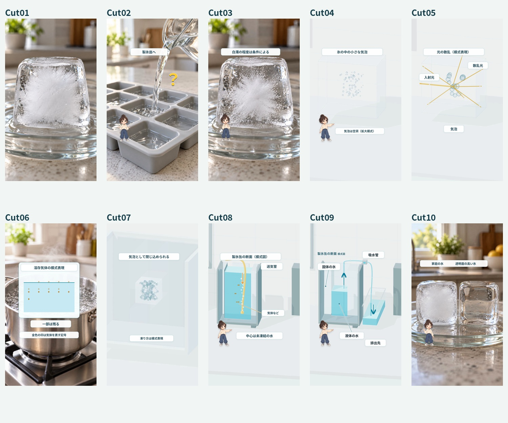

# EP004「白い氷」V3 素材納品

10カットの独立した無音素材。1080×1920 / 30fps。台本V8 LOCKは `source/LOCKED_NARRATION_V8.txt` に原文保存。タイミングは仮（合計46.6秒）。全編を組み立てたMP4は制作していません。



## ダウンロード

[ZIP A：Cut01–05](../releases/EP004_ICE_V3_full_A_cuts01-05.zip) / [ZIP B：Cut06–10](../releases/EP004_ICE_V3_full_B_cuts06-10.zip) / [ZIP C：ソース・プレビュー](../releases/EP004_ICE_V3_full_C_sources-preview.zip)

A・B・Cを同じ場所へ展開してください。Cには一覧・工程比較・縮小ガイドを同梱。全解像度の追加確認フレームはGitHubのpreviewフォルダにも保存しています。旧stage1 ZIPは2カットのみなので、今回の受け渡しには上の3点を使用します。

## ChatGPT Workへの受け渡し

1. GitHubの納品ZIPをすべて同じ場所へ展開。`index.html`で各カットを確認。
2. 各cutの`animation.mp4`はラベルとキャラクターを合成した参考用。素材としてそのまま使うこともできます。
3. 編集は`base_animation.mp4`＋`labels_overlay.webm`＋必要な`character_overlay.webm`を推奨。**合成済み版に透過レイヤーを重ねると二重表示になります。** Cut01は単一動画。
4. 透過WebMはVP9 alpha。FFmpegは入力前に`-c:v libvpx-vp9`を付けてください。alpha非対応の編集ソフトではソースから連番PNGを出力できます。静止キャラクター原本とモーション設定も同梱。
5. 完成VOに合わせてカットを再配置・必要なら速度調整。ナレーション、字幕、黄色い帯、全体に同期する進行バー、BGM/SEはWork側で追加。
6. 字幕の読点「、」は除き句点「。」は維持。素材内の短いラベルは字幕ではありません。

## カットとレイヤー

| Cut | 仮開始 | 秒 | 内容 |
|---|---:|---:|---|
|01|0|3.5|承認済みの白い氷。元ファイル維持|
|02|3.5|6.5|沸騰・冷却・注水・疑問符。完成した氷なし|
|03|10|4|白濁が残る一例。白濁量は条件に依存|
|04|14|5|実写風の氷から内部の気泡へ拡大|
|05|19|3.5|立体の空洞と模式光線。複数方向の散乱|
|06|22.5|2.5|沸騰と別枠の溶存気体模式。気体はゼロにしない|
|07|25|6.5|製氷皿断面。凍結・気体の集積・気泡|
|08|31.5|5.5|製氷缶での遅い凍結と送気。水は排出しない|
|09|37|5.5|承認済み。中心の液体を管で吸引。固体の氷は残す|
|10|42.5|4.1|仕上げ後への時間移動。白い氷と透明度の高い氷|

承認済みCut01/Cut09の画像・動画はSHA256で保存状態を照合。今回の追加分は`source/full_v3/`。以前の第1段階メタデータはその下の`stage1_metadata/`に保存。

## セーフゾーン

重要な図解・ラベルは原則x72–920 / y320–1480。字幕x96–920 / y1500–1740、帯x80–1000 / y150–292、進行バーy78–92を予約。背景は全画面。写真の物体輪郭は画面いっぱいに広げ、白濁や透明度を判別する中心部分を優先。右側UIから重要部を離しています。ガイド付き縮小画像は`preview/full_v3/`。

Cut07は後半に中心へ連続して寄る演出を加えています。`base_render.mp4`が元の全体像、`base_animation.mp4`が寄りを適用した編集用です。`camera_motion.json`と`source/full_v3/camera_push.py`で倍率・開始位置を変更可能。文字レイヤーは拡大せず、字幕領域を維持しています。

## 編集ソース

```bash
npm ci --cache /tmp/nnz-v3-npm-cache
node --test EP004_ICE_V3/source/physics.test.mjs EP004_ICE_V3/source/full_v3/states.test.mjs
node EP004_ICE_V3/source/full_v3/render.mjs --stills
# 残り8カットの素材動画のみをレンダリング
node EP004_ICE_V3/source/full_v3/render.mjs --media
```

Chromium実行パス`/usr/bin/chromium`、GLは`swangle`。Three.js 0.180は同梱、追加の外部APIは不要。既存出力を削除せずに再実行すると既存base/overlay動画は再利用します。改変後の再生成は複製したプロジェクトで、対象cutの生成済みbase/overlay（Cut07はbase_renderも）を除いてから実行してください。既存成果物は元の場所に保持します。承認済み2カットは旧`source/render.mjs`ですが、通常は再生成不要です。

## 科学表現・権利・残る確認

- 写真風素材はAIによる再現であり、実験の記録ではありません。権利・生成由来は`licenses/`に記録。
- 氷の内部は説明のため可視化。気泡の寸法・個数・光路・凍結速度は実測ではありません。Cut06の金色の印は溶存気体の記号で、肉眼で見える粒子や沸騰の大泡ではありません。
- Cut07の凍結方向は模式。全製氷皿で同一の形に凍るという意味ではありません。Cut08–09は送気管（橙）と吸水管（青）を区別。
- Cut09は中心の液体が管を通って受け器へ移動。固体を削らず、消失や透明塊への変化もなし。Cut10は仕上げ工程後の別ショット。
- 参考URLは `https://kokuboice.co.jp/rockice/step/` と `https://icenet.or.jp/about_koriya_junpyo/`。この環境のネットワーク制限で本文を再取得できていません。公式写真・イラストは不使用。工程の最終確認とG3は別途必要です。
- 元の正式な黄色い帯の独立ファイルは未確認。素材には帯を焼き込んでいないため、Workで提供済み原本を重ねてください。既存の別版を正式原本として代用していません。
- Google Drive連携はありません。GitHubのZIPを受け渡しに使用。

技術検査と目視検査の詳細は`qc/full_v3/report.json`。自己QCはG3の代替ではありません。

## 追加した共通素材

9件の新規IDとバージョン1.0.0を `common_assets/nichijou_naze/props/ice_v3/v1.0.0/manifest.json` に登録。白い氷・工程・条件差・比較・工場の写真風5資源と、気泡/散乱・家庭凍結・送気・吸引の3D4資源です。既存のキャラクターとテンプレートは維持。台帳JSON/CSV/Excelには追記し、`node tools/ice-assets.mjs <ID>`で参照できます。
